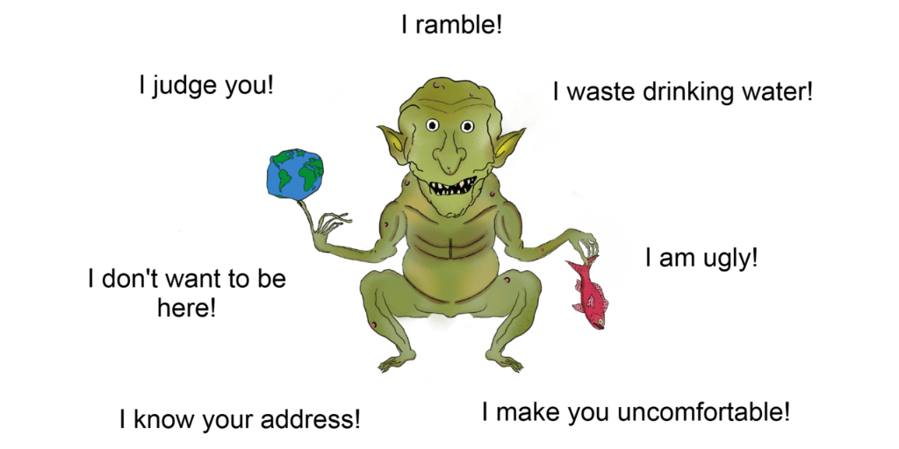

<p align="center">
  
</p>

# Meet Grimlo the Desktop Gremlin!

An eccentric, melodramatic desktop gremlin who floats over your windows, talks out loud, critiques your computer habits, and chats using Google Gemini, Claude, or OpenAI.

Think Bonzi Buddy, minus the spyware, the toolbars, and the lawsuits.

---

## ✨ Features

- **Layered Art Rig & Viseme Lip-Sync**: Grimlo's mouth, eyes, pupils, and ears dynamically react to speech visemes, drag physics, mouse twitches, and idle states.
- **AI Brain Streaming**: Multi-provider support (Google Gemini, Anthropic Claude, OpenAI) with streaming responses and secure DPAPI-encrypted credential storage.
- **Ambient System & Screen Awareness**:
  - **Foreground Window Roasting**: Glances at your active apps and delivers witty remarks.
  - **Media & Audio Critique**: Detects active Spotify, YouTube, or browser sessions and compares them to Spandau Ballet.
  - **Late-Night & Battery Alerts**: Remarks on ungodly work hours and low battery status.
- **Desktop Wander & Screen Edge Pacing**: Periodically shuffles along your taskbar with dynamic bodily sway and footstep sounds to stretch his legs, inspects the area, and returns to his post.
- **Sleep & Drowse Cycles**: Eyelids droop at half-inactivity (default ~4 minutes), transitioning to deep sleep with snores and floating `z`'s (default 8 minutes, configurable from 3 to 20 minutes in Settings). Click him to startle him awake!
- **Tactile Drag Physics & Dizziness**: Pick him up and drag him around. Shake him rapidly back and forth to make him dizzy with cartoon spin SFX.
- **Custom Retro Sound Effects**: Synthesized audio cues for tapping the monitor glass, popping chat bubbles, dizziness, footsteps, snores, and waking up.
- **Clean Chat Bar & Slash Commands**: Toggle chat with a single click (or Esc to dismiss), with support for `/look`, `/judge`, `/listen`, `/wander`, `/sleep`, `/tap`, `/shake`, and `/help`.
- **System Tray Integration**: Minimize Grimlo to the system tray, toggle topmost, mute, or quit anytime.

---

## 🚀 Quick Start (Pre-built Release)

1. Download the latest release from the [Releases](https://github.com/noahdwaddell/grimlo/releases) tab (or run `.\package.ps1` to build your own zip).
2. Extract the zip and double-click `Grimlo.exe`.
3. Left-click Grimlo to chat, or right-click him for **Settings...** and **Help & Commands**.

> **Free API Key**: You can get a free Google Gemini API key at [aistudio.google.com/api-keys](https://aistudio.google.com/api-keys). Paste it into Grimlo's Settings ➔ AI Brain tab!

---

## 💬 Chat Slash Commands

Click Grimlo to open the chat bar, type any command, and press **Enter**:

| Command | Action |
|---|---|
| `/think [prompt]` | Unleashes an elaborate, deep-thinking monologue or detailed treatise |
| `/long [prompt]` | Alias for `/think` — lifts the 1-3 sentence brevity limit for in-depth answers |
| `/look [prompt]` | Captures your desktop and provides Grimlo's visual critique |
| `/judge` | Harshly roasts your active foreground window |
| `/listen` | Critiques currently playing music or audio |
| `/wander` | Takes an animated walk along your taskbar |
| `/sleep` | Sends Grimlo to sleep immediately |
| `/tap` | Taps the monitor glass from the inside with audio SFX |
| `/shake` | Triggers dizzy spin and complaints |
| `/clear` | Wipes short-term conversation memory |
| `/help` | Speaks a summary of available tools |
| `Esc` | Closes the chat bar |

---

## 🛠️ Building & Packaging from Source

### Prerequisites
- Windows 10 or 11 (64-bit)
- [.NET 8 SDK](https://dotnet.microsoft.com/download/dotnet/8.0)

### Run in Development
```powershell
dotnet run --project Grimlo\Grimlo.csproj
```

### Build Distribution Package
Run the automated packaging script to produce a clean distribution zip in `dist/`:
```powershell
.\package.ps1
```

To create a self-contained single-file bundle that includes the .NET runtime:
```powershell
.\package.ps1 -SelfContained
```

---

## 📜 License

This project is dual-licensed:
- **Source Code & Software:** Licensed under the [MIT License](LICENSE).
- **Artwork, Character Rig & Visual Assets:** Copyright © 2026 Kris Sanford. All Rights Reserved. (Permitted for personal use only as part of running the Grimlo application; may not be extracted, modified, or redistributed without written permission).

See [LICENSE](LICENSE) for full legal terms.
